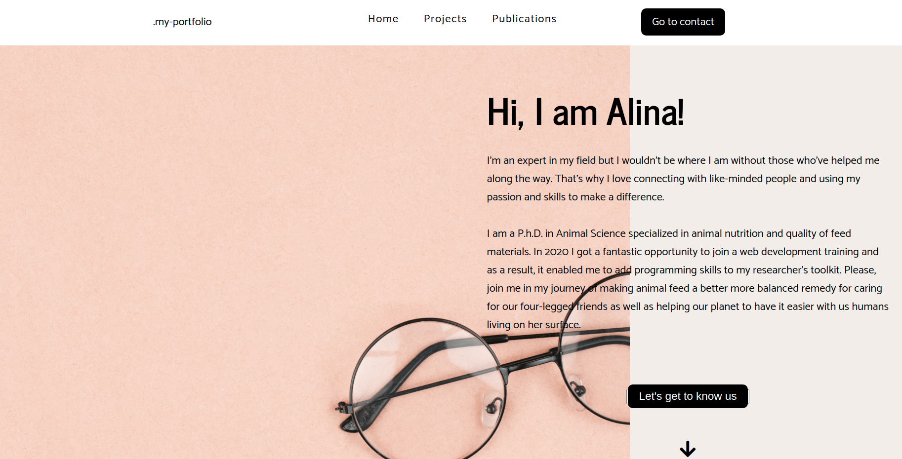

# portfolio-in-react 👩‍💼 developer portfolio

🔄 Update 2022

Let's get to know each other! A portfolio website of junior web developer made with 💖 in ReactJS. With a blog feature. See you there!

This project was deployed with ❤️ on GitHub.



## PFE-10 architecture decision

The primary portfolio is one root page with persistent navigation and footer.
Home (including Story), Projects, My Values, Blog, and Contact appear as sections.
Internal navigation uses native fragments:
`#home`, `#projects`, `#values`, `#blog`, and `#contact`. There is no client-side router or
additional state/service layer in the primary experience.

On GitHub Pages, `/portfolio-in-react/#blog` loads the physical root page;
the fragment is handled in the browser and is not sent to the server. Direct loads and refreshes therefore work without an SPA fallback. An unknown fragment
still displays the complete root portfolio, without a separate error screen.

The legacy `/projects/:id` route is retired, along with the other standalone
section URLs. Existing nested URLs return the static host's 404; compatibility
redirects and a custom 404 workaround are intentionally not introduced.
`ProjectsInfo`, the project data, and `Soon` remain available for future reuse,
but are not exposed as routes. Projects and Blog retain their placeholder content.

Substantial case studies (for example, Elowen and Constellation) can be added
when needed. Semantic `/projects/:slug` URLs would require generated physical
pages or hosting with supported route fallbacks before they can be introduced.

Run `npm test` for the architecture checks and `npm run build` for the production artifact. Preview `dist/` mounted under `/portfolio-in-react/` on a static server without fallback support. Verify the root page and fragment URLs, asset responses, and expected 404s for retired nested URLs before publishing.

## Development and verification

The build platform is Vite with the React plugin. React 17 and the existing
components and public images are retained. Application styling uses native CSS;
Bootstrap, React-Bootstrap, and Sass are no longer dependencies. Node 20.19+ or
22.12+ is required; the package engine range lists the supported versions.

```bash
npm ci
npm run dev
```

Open `http://localhost:5173/portfolio-in-react/`. `npm start` is an alias for
the same development server. The repository-root `index.html` loads
`src/index.jsx`. `vite.config.mjs` sets the repository base path for development
and production. Asset references use `import.meta.env.BASE_URL`; files in
`public/img` are copied unchanged to `dist/img`.

```bash
npm test          # Run the saved tests once with Vitest and jsdom
npm run test:watch
npm run build     # Generate dist/
npm run preview   # Preview the production artifact, normally on port 4173
```

Tests stay beside their code in `src/App.test.jsx`. They cover the persistent
layout, section navigation, story-card structure and image URLs, fragment entry points,
and the retained project detail component. PTST-4 technical assertions use stable
section IDs, roles, and URL targets rather than legacy headlines or CTA labels.
PFE-12 content/style snapshots remain separate in `src/LandingStyles.test.jsx`.
These DOM tests do not verify visual layout or scrolling. CRA/Jest flags such as `--watchAll` and `--watchman` are no
longer needed.

### Browser-test tooling (PTST-5)

Playwright Test is installed as a development dependency. Install its Chromium
browser after installing the npm dependencies:

```bash
npx playwright install chromium
npx playwright --version
```

`playwright.config.js` uses one headless Chromium browser, a default 1440×900
viewport, and browser specs in `tests/e2e/**/*.spec.js`. `npm run test:e2e` runs
Playwright; `npm test` runs Vitest's `src/**/*.test.jsx` checks.

See [visual verification](docs/testing/visual-verification.md) for directory
ownership and local commands. Each run generates an HTML report; inspect it with
`npx playwright show-report playwright-report`.

Playwright always builds and starts a fresh production preview on port 4173,
using `/portfolio-in-react/` as its base URL, to avoid stale output. Port 4173
must be free. Use relative URLs such as `./` and `#contact` in browser specs so
they retain the repository base path.

`tests/e2e/portfolio.spec.js` captures desktop (1440×900), tablet (768×1024)
and mobile (375×812) at device scale factor 1. It checks actual viewport dimensions,
visible sections, loaded images/fonts, expected grid columns and runtime errors.
Screenshots (`portfolio-desktop.png`, etc.) and JSON metadata are saved via
Playwright's `testInfo.outputPath()` in runner-managed folders under `test-results/`.
The console prints the paths. Metadata records browser/viewport details, source
revision and working-tree status, build/screenshot hashes, actual PNG dimensions
and horizontal overflow. These outputs are disposable and replaced on the next run.
Full-page PNG dimensions can exceed the CSS viewport if content overflows; use
metadata to distinguish them. These are render/capture checks, not automated
visual-diff or keyboard-navigation assertions.

| Location | Purpose | Git policy | Lifecycle |
| --- | --- | --- | --- |
| `src/**/*.test.jsx`, `src/__snapshots__/` | Vitest structural/style tests and references | Tracked | Maintained |
| `tests/e2e/` | Playwright browser test source | Tracked | Maintained |
| `tests/e2e/*-snapshots/` | Approved visual regression references, if introduced | Tracked | Maintained |
| `visual-checks/` | Developer-selected Jira investigation evidence | Ignored | Retained as needed |
| `test-results/` | Automated screenshots, metadata and diagnostics | Ignored | Disposable |
| `playwright-report/` | HTML reports when generated | Ignored | Disposable |
| `playwright.config.js` | Browser test configuration | Tracked | Maintained |

Tests do not write to `visual-checks/`. To retain evidence for an investigation,
explicitly copy selected artifacts into its ticket folder and record context in
`notes.md`. The PFE-12 and PFE-14 evidence stays there. No approved Playwright
snapshot directory is created until visual regression assertions are introduced
and their references reviewed. No additional browser testing framework or
cross-browser matrix is configured.

### Native CSS ownership and regression checks (PFE-14)

PFE-12 established style ownership; PFE-14 retains it in `src/styles/`.
`main.css` composes native CSS imports and the existing web-font request.
`base/_reset.css` owns the application reset and image/SVG defaults.
`base/_globals.css` owns the effective typography and link defaults that were
previously supplied by application Sass and Bootstrap.

The layout files have explicit owners: `_portfolio.css` handles the root layout,
anchor offsets, shared anchor-button appearance/states, and the Projects placeholder
columns; `_header.css` handles navigation; `_home.css` handles home images and the
arrow; `_story.css` handles cards; `_contact.css` handles contact columns; and
`_footer.css` handles the footer. Responsive rules live beside their owners.
The existing 600px header, 900px section stacking and 576px Projects breakpoints
are preserved. The header/reset order, typography, spacing, image crops, blue
link/button-border colors, and focus-ring rules are intentionally retained.

Story uses native divs, images and anchors. Existing class names such as `card`,
`btn`, `lead`, `row` and `col-sm-4` are now application-owned CSS selectors;
there is no Bootstrap stylesheet or React-Bootstrap component dependency.
The rendered markup, copy, data, imagery and navigation semantics remain unchanged.

`src/LandingStyles.test.jsx` reads native CSS imports and captures landing markup
and selected styles at widths of 1440, 768 and 375 pixels. During PFE-14, its
style comparison was corrected for jsdom's source-order/specificity and important
shorthand limitations. The three style snapshots were regenerated from the saved
PRE-migration compiled stylesheet, not from the candidate. The native CSS passes
those reviewed expectations; the markup snapshot is unchanged. The original PFE-12
snapshots remain preserved with local before evidence. No visual differences are
intended by these test-model changes.

Run `npm test` to compare against the snapshots; do not update them merely to
silence a regression. These checks cover the current simple selectors, not the
entire browser cascade specification. jsdom does not calculate browser geometry,
load web fonts, or establish keyboard focus/scrolling behavior. The tests supplement
browser review; they cannot prove pixel or interaction parity.

Local before/after evidence is kept under the ignored `visual-checks/PFE-14/`.
Browser comparison and focused interaction verification remain pending; incomplete
captures do not prevent implementation, but are not reported as completed acceptance.

## Production and GitHub Pages

My Values (`src/components/Values.jsx`) uses the existing `public/img/soil.jpg`
photograph with an arched crop and a decorative CSS accent. Its styles live in
`src/styles/layout/_values.css`; text and photo stack below 900px. The Read More
link targets the existing `#blog` placeholder until blog content is available.
Projects remains reserved for a future external animal nutrition tool.

The deployment base remains `/portfolio-in-react/`. Use section URLs such as `/portfolio-in-react/#projects` for direct loading and refreshes.

Vite preview provides a convenient production check but includes SPA fallback behavior. For a GitHub Pages parity check, mount `dist/` as `portfolio-in-react/`
on a plain static server. The root and fragment URLs must load; retired nested URLs such as `/portfolio-in-react/projects/0` should return 404.

The existing explicit publishing command is `npm run deploy`. Its predeploy step builds the site, and `gh-pages` publishes `dist/`. Running a build or preview
does not publish anything.

## Historical learning notes

The notes below document the original CRA application and learning exercises.
They are retained for reference, not as current setup instructions. In particular, CRA, BrowserRouter, node-sass, and the old build directory instructions are obsolete.

## GitHub Workflow

1. Create a repo on GH

   - Create a directory which has exactly the same name.
   - Go to that directory.

   ```bash
   cd test
   echo "# react-project" >> README.md
   git init
   git add README.md
   git commit -m "first commit"
   git branch -M main
   git remote add origin https://github.com/profilename/test.git
   git push -u origin main
   ```

2. Create a parallel branch and check the status of branches. Is it up to date? What changes are staged for that branch? Display all branches, and show which is your current.

   ```bash
   git checkout
   git status
   git branch
   ```

3. Create another branch and set upstream - another branch with remote tracking, associated with local branch

    ```bash
    git checkout newbranch
    git push --set-upstream origin newbranch
    git add .
    git commit -m "your branch"
    ```

4. after completing some changes, push them to the current branch and switch to the main.

   ```bash
   git push
   git checkout main
   ```

5. Update the main

   ```bash
   git pull
   git add .
   git commit -m "update to the main"
   ```

6. Switch to the newbranch and merge it with updated main

   ```bash
   git checkout newbranch
   git merge main newbranch
   git add .
   git commit -m "update from the main"
   ```

By this way your branch will get all the changes that were made to the main.

In order to merge changes from the other branch to the main, make sure that those changes are what you would like to introduce and there will be least conflicts possible.

```bash
git checkout main
git merge newbranch main
git add .
git commit -m "update from the newbranch"
```

## Getting Started with Create React App

## ReactJs

A JavaScript library to build web apps
what makes React so special

- Components
- State
- SPA

## files in React

### App.js

All the code you write in your App component which acts as the root component gets rendered to this HTML file. This means that there is only one HTML file where your code will be rendered to -Single Page App.

React Router – like the name implies – helps you route to/navigate to and render your new component in the index.html file. So as a single page application, when you navigate to a new component using React Router, the index.html will be rewritten with the component's logic.

### manifest.json

The web app manifest provides information about an application (such as name, author, icon, and description) in a JSON text file

### reportwebvitals

Tool for measuring the real life performance of your app(very new to React)
more on that [web-vitals](https://www.npmjs.com/package/web-vitals)

## To start React Project

**Remember:**

- Don't foget before starting the project with npm start DON'T FORGET to cd app-name.
- "public" is the data for the published version
- "src" is with one is working with
- both .js and .jsx extensions work in react
- index.js should contain imports and ReactDOM.render() only

### step 1 Installations

#### React and deployment

```bash
 npm init
 npm i --save-dev gh-pages
 npx create-react-app <app-name>
 cd <app-name>
 npm start
```

##### Deploy React apps in GH pages

###### Installing gh-pages packages

```bash
npm install gh-pages
```

###### Adding homepage in package.json

Adding homepage into **package.json**

```json
"homepage": "http://<your-gh-username>.github.io/<your-repo-name>"
```

###### Added scripts

Delete 'test' scripts.
Adding some more scripts into **package.json**

```json
"scripts": {
//...
"predeploy": "npm run build",
"deploy": "gh-pages -d build",
}
```

###### Build

Lastly run build script to generate build dir

```bash
npm rum build
npm run deploy
```

### step 6 Build

To create gh-pages version, in the root directory one writes in another, new terminal window:

```bash
npm run build
```

or to update the gh-project:

```bash
npm run build
```

Follow this worklow to update either version control as well as gh-pages:

```bash
git add . && git commit -m "message"
git push
npm run build // create or update dist folder
npm run deploy // create or update gh-pages
```

## To install fontawesome icons packages

```bash
 npm i --save @fortawesome/fontawesome-svg-core
 npm install --save @fortawesome/free-solid-svg-icons
 npm install --save @fortawesome/react-fontawesome
 npm install --save @fortawesome/free-brands-svg-icons
 npm install --save @fortawesome/free-regular-svg-icons
```

## To install react icons package

```bash
npm install react-icons --save
```

### To use fontawesome icons via Individual Use

Import icons into each component.

```jsx
 import { FontAwesomeIcon } from '@fortawesome/react-fontawesome'
 import { faCoffee } from '@fortawesome/free-solid-svg-icons'
 const element = <FontAwesomeIcon icon={faCoffee} />
 ReactDOM.render(element, document.body)
```

## Installing Router to handle links

```bash
 npm install react-router-dom
```

To make React Router available anywhere in your app change index.js.

All we do is to replace React.StrictMode with BrowserRouter which is imported from react-router-dom.  Now the router features are accessible from any part of your app.

```javascript
import React from 'react';
import ReactDOM from 'react-dom';
import './index.css';
import App from './App';
import { BrowserRouter } from "react-router-dom";

ReactDOM.render(
  <BrowserRouter>
    <App />
  </BrowserRouter>,
  document.getElementById("root")
);
```

## Known errors

### react-router-dom update

```bash
npm install --save react-router-dom
```

## More reading

### VS Extensions

To make life easier:

TODO Write what you like

## Would you like to create a server-side app?

TODO Write what you like

### Basic Express setup

To start new express project

```bash
npm init -y
echo "PORT=5000\nDB_URL=mongodb://localhost:27017/users" > .env
echo "node_modules/" > .gitignore
npm i express
npm i dotenv
npm i morgan
npm i mongoose
npm i bcrypt
npm i uuid
npm i multer
npm i nodemon --save-dev
touch server.js app.js
<!-- or server.js -->
npm i concurrently
npm i cors
mkdir models controllers routes uploads
<!-- and client? -->
touch models/userModel.js
touch models/sessionModel.js
touch controllers/userController.js
touch controllers/authController.js
touch routes/auth.js routes/user.js routes/users.js routes/plants.js
<!-- touch/middleware/... -->
```

Hint: You may change the link for the mongoDB database, by creating account on Mongo Atlas, and store your data in the cloud.

- json script to start project on npm run dev, without the need of starting Backend and Frontend seperately, which you achieve by installing 'concurrently' package:

```json
"scripts": {
    "start": "node server/server.js",
    "server": "nodemon server/server.js",
    "client": "npm start --prefix  client",
    "dev": " concurrently  \"npm run server\" \"npm run client\" "
  },
"dependencies": {
    "concurrently": "^6.2.2",
    "cors": "^2.8.5",
    "dotenv": "^10.0.0",
    "express": "^4.17.1",
    "mongoose": "^6.0.8",
    "morgan": "^1.10.0"
  },
```

- script for global start of the server app:
  "start": "nodemon server.js"
- create new DB in mongo shell

```bash
  use users
  use data
```

Example database was filled out directly from MongoDB Compass, and then stored on the Atlas by creating a link.

### Additional packages for more advanced backend work

```bash
npm i bcrypt
npm i cookie-parser
npm i express-session
npm i express-validator
npm i uuid
npm i multer
```
